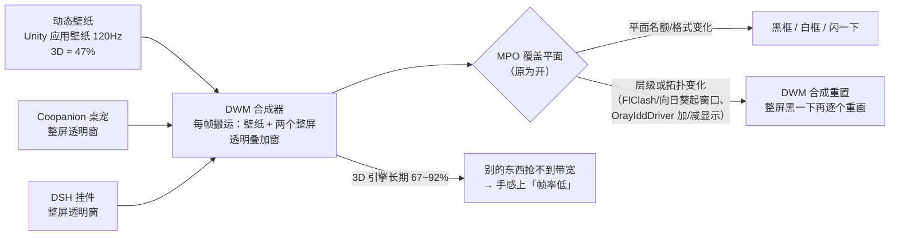

# 🖥️ 桌面渲染 / 卡顿排查（黑框白框、整屏黑一下再恢复）

> 触发（用户原话）：
> **「现在桌面帧率感觉有点低，而且打开 flclash、向日葵之类的有概率刷成黑框或者白框，
> 有时候也会突然卡顿一下整个桌面变黑后过一段时间逐步恢复」**
>
> 本文记录 **2026-10-11** 在本机（Windows + Intel Arc 核显 + 动态壁纸 + 两个桌宠）上的实测事实、
> 判读结论、已做的改动与回滚方法。复测请跑 [`tools/desktop-render-report.ps1`](../tools/desktop-render-report.ps1)。

---

## 0. 一句话结论

| 现象 | 根因（本机实测） | 处理 |
|---|---|---|
| 桌面「帧率感觉低」 | **不是面板降频**（实测 120.5 Hz）。是**动态壁纸常驻吃掉约 47% 的 3D 引擎**，加上 MPO 在多平面之间反复搬运 | 壁纸见 §4；MPO 已关（§3） |
| 打开 FlClash / 向日葵**闪黑框白框** | **MPO（多平面覆盖）** 与「分层 + 透明 + 置顶」的窗口组合打架；向日葵还带一个**虚拟显示器驱动** `OrayIddDriver` | MPO 已关（重启生效）；全屏时桌宠自动隐藏已开；见 §5 |
| **整个桌面黑一下再逐步恢复** | **不是显卡驱动崩**（系统日志里没有一次 4101/4102 驱动重置）。是 **DWM 合成重置**：窗口层级/覆盖平面/显示拓扑变化时，DWM 重建整屏合成，各窗口一个一个重画 | MPO 已关；向日葵虚拟屏按需禁用 |

---

## 1. 本机事实（2026-10-11）

| 项 | 值 |
|---|---|
| 显卡 | Intel(R) Arc(TM) Graphics（Meteor Lake 核显），驱动 `32.0.101.8509`（2026-02-05） |
| 第二显卡 | `OrayIddDriver Device` `17.50.19.949` —— **向日葵的虚拟显示器驱动**（间接显示，非真显卡） |
| 屏幕 | 3120×2080 @ **120 Hz**，200% 缩放 |
| 系统 | Windows 11 25H2 build `26200.9457`（注册表 `ProductName` 仍旧写着 Windows 10 Home China） |
| HAGS（硬件加速 GPU 计划） | `HwSchMode` 未设置 = 驱动默认 |
| MPO | `HKLM\SOFTWARE\Microsoft\Windows\Dwm\OverlayTestMode` 原本**未设置 = 开着** |
| 驱动重置 | **无** 4101/4102 事件；`Display` 提供程序也无事件 |
| 动态壁纸 | Lively 2.x 承载 Unity 应用壁纸 `MisideStartWallpaper.exe`（`C:\Users\HUAWEI\Desktop\MisideStartWallpapaer\`） |
| 壁纸守护 | 同目录 `wallpaper-power-guard.ps1`（被遮住 / 空闲 / 电池时 `SW_HIDE` 隐藏壁纸），日志 `%LOCALAPPDATA%\Lively Wallpaper\wallpaper-power-guard.log` |
| 叠加层 | Coopanion 桌宠（Electron，控制台 17788）+ DSH 挂件（Electron，本地服务 3090），两个都是**整屏透明窗**；实测时两者 `alwaysOnTop = false` |

## 2. 实测数据

**屏幕刷新率**（在桌宠页面用 `requestAnimationFrame` 连数 2 秒）：240 帧 / 2.01 s，帧间隔中位 **8.30 ms** → **120.5 Hz**（最小 8.20 / 最大 11.40）。
→ 面板没有掉到 60 Hz，「帧率低」是**合成负载**，不是显示模式被改。

**GPU 引擎占用**（`Get-Counter '\GPU Engine(*)\Utilization Percentage'`，按进程汇总 3D 引擎）：

| 进程 | 3D 占比 | 说明 |
|---|---|---|
| `MisideStartWallpaper` | **44–47%** | 动态壁纸，常驻；120 Hz × 3120×2080 的 Unity 场景 |
| `dwm.exe` | 5–14% | 桌面窗口管理器：合成壁纸 + 两个透明叠加层 |
| Coopanion `electron` | 2.5–23% | 波动大（开控制台页面 / 走动时升高） |
| `Code.exe` | 4–6% | VS Code |
| `FlClash` | 1–2% | |
| 合计 | **67–92%** | 核显 3D 引擎长期在高位 |

**壁纸守护状态**：`decision: run=True reason=desktop visible`，`coverRatio=0.9`，壁纸 pid 7244 `visible=True`，进程 CPU 143.9 s、工作集 877 MB。日志显示守护工作正常（被 B 站全屏盖住时确实隐藏过）。

**Lively 设置**：`AppFocusPause=1 AppFullscreenPause=0 BatteryPause=1 PowerSaveModePause=1 ProcessMonitorAlgorithm=3 ProcessTimerInterval=500` —— 这些对 **应用类型壁纸**（本机就是 Unity 程序）**不生效**（上游只对网页/视频类壁纸暂停），所以壁纸的「该停就停」只能靠上面那个自定义守护脚本。

**壁纸自身的旋钮**：`MisideStartWallpaper_Data\boot.config` 只有 `gfx-enable-gfx-jobs / gfx-threading-mode / gc-max-time-slice` 之类线程配置，**没有帧率或渲染分辨率的开关**；Lively 也没有给应用壁纸提供帧率/画质设置。→ 壁纸的 GPU 成本**只能靠「该藏就藏」来省**，省不掉的部分就是它的固有代价。

## 3. 已做的改动

### 3.1 关掉 MPO（改注册表，**重启后生效**）

```powershell
# 关（本机已执行 2026-10-11 13:47）
New-ItemProperty -Path "HKLM:\SOFTWARE\Microsoft\Windows\Dwm" -Name OverlayTestMode `
  -PropertyType DWord -Value 5 -Force

# 撤销（把值删掉就恢复 Windows 默认）
Remove-ItemProperty -Path "HKLM:\SOFTWARE\Microsoft\Windows\Dwm" -Name OverlayTestMode
```

- 原值记录：`%USERPROFILE%\dsh-whale-backups\mpo-before-20261011-134732.txt`
- 生效方式：**重启**（重启 DWM 进程也能生效，但会闪一次屏，所以没自动做）
- 为什么是这个数：`OverlayTestMode=5` 是 Windows 上「关闭 MPO」的官方测试开关（也写作 `DisableOverlays`），
  是「分层窗口 + 透明叠加 + 核显」组合下黑框/白框/闪屏最常见的一招；代价是合成全部走 DWM 拷贝路径，
  全屏游戏少数场景可能多占一点 GPU / 掉一点全屏优化。

### 3.2 桌宠「全屏时自动隐藏」打开

控制台（`http://127.0.0.1:17788/#/pet`「习惯」页）里勾上「全屏时自动隐藏」→ 落盘
`third-party/Coopanion/build/data/home/companion/config.json` 的
`worlds['desktop-pet'].window.hideWhenFullscreen = true`。
玩游戏 / 看全屏视频 / 向日葵全屏接管时桌宠先躲起来，少一个整屏透明层去和别的东西抢覆盖平面。

## 4. 还建议做的（需要你点头，或者自己两下就能做）

| 动作 | 收益 | 代价 / 怎么撤销 |
|---|---|---|
| **重启一次**（让 §3.1 的 MPO 设置生效） | 黑框白框/闪屏最大概率消失；DWM 搬运层数变少 | 无。想回到原样就删掉那个键值 |
| **向日葵不用时禁用 `OrayIddDriver Device`**（设备管理器 → 显示适配器 → 右键禁用） | 少一个虚拟显示器：显示拓扑变化导致的「整屏黑一下」明显变少 | 远程被控时向日葵可能需要它；要用再启用 |
| **向日葵里关掉硬件加速 / 降画质**（设置 → 显示 → 硬件加速编码/渲染） | 抓屏与渲染不再和 DWM 抢同一个核显 | 远程画面质量下降 |
| **壁纸守护把 `-CoverRatio` 收到 0.75**（现在是 0.9） | 窗口盖住桌面 75% 就隐藏壁纸 → 干活时 3D 占用立刻掉到个位数 | 壁纸更早「不见」；改回 0.9 即可（改启动参数或直接跑 `-Resume` 之外的那条命令） |
| **玩游戏/看视频前手动 `wallpaper-power-guard.ps1 -Status` 看一眼** | 确认壁纸此刻是「该藏」的状态 | — |
| 桌宠帧率从「60」改「30」，或把「走动」从「随刷新率」改「多待着」 | 桌宠自身占用从 ~3% 降到 ~1%，走动时不再整屏 60 fps 重绘 | 动画没那么顺；控制台「习惯」页点回去即可 |

> 不要动壁纸本身（Unity 那个），它没有帧率/分辨率开关；能省的部分只有「别让它一直画」。

## 5. 为什么这三个现象是同一个故事



- **黑框白框**：窗口被提升成「覆盖平面」后，窗口自己的内容还没画好/格式不匹配，硬件就把空层直接扫出去 —— DWM 来不及兜底就是黑或白。
- **整屏黑一下再逐步恢复**：DWM 检测到合成前提变了（新窗口层级、显示拓扑、平面分配），**重建整屏合成**；重建期间桌面先刷成黑，之后各窗口一个个重画 —— 所以是「黑一下，再慢慢恢复」。
- **帧率感觉低**：核显 3D 引擎常年在 67–92%，加上多平面在显示控制器里来回搬运，鼠标拖动、窗口滚动的手感都会变钝。

## 6. 复测怎么做

```powershell
# 一次看清：屏幕多少 Hz / 谁在吃显卡 / MPO 状态 / 有没有驱动重置 / 我们两个挂件的档位
powershell -ExecutionPolicy Bypass -File tools\desktop-render-report.ps1

# 只看显卡占用前 5 名
powershell -ExecutionPolicy Bypass -File tools\desktop-render-report.ps1 -Top 5
```

想量化「壁纸到底值多少」：对壁纸窗口做一次隐藏再显示（`SW_HIDE` / `SW_SHOW`，守护脚本 `-Resume` 也会恢复），
前后各跑一次上面的脚本比合计值。桌宠页面的 `requestAnimationFrame` 计数（§2）则用来看屏幕有没有降频。
